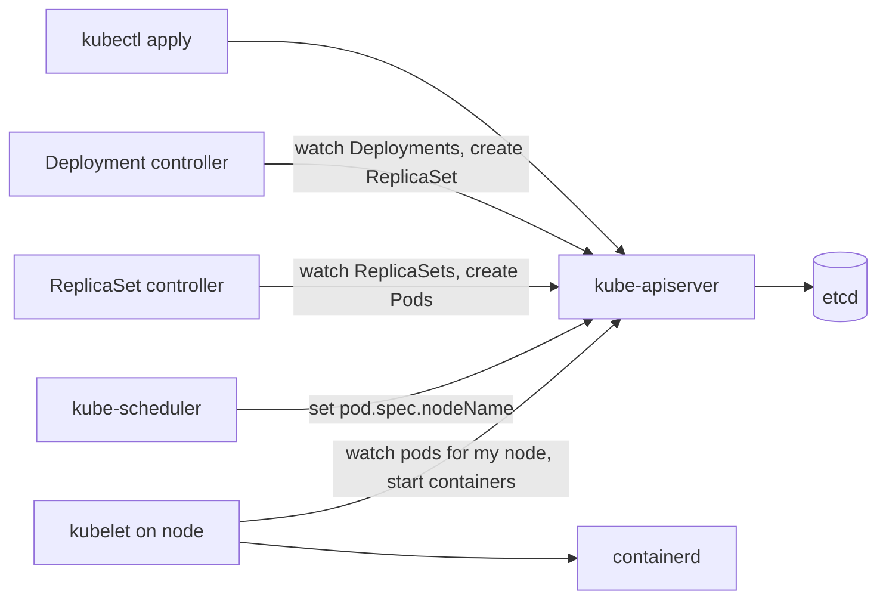
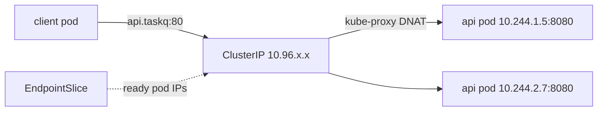

# 05 Pods, Deployments and Services (Weeks 3-6)

**Goal**: run the api and worker on kind, understand the controllers that keep them running, and route traffic to them through a Service. You should be able to write [40-api.yaml](taskq/k8s/40-api.yaml) from a blank file by the end of week 4.

## The mental model: desired state and control loops
You never "run" anything in Kubernetes. You write **desired state** into the API server (stored in etcd), and controllers keep moving the **actual state** toward it.



Each arrow is a component **watching** the API and **writing** to it. Nothing talks to anything else directly. When something is stuck, ask: "which controller should have acted next, and why didn't it?"

## Pods
The smallest unit: one or more containers that share a network namespace (one IP, `localhost` between them), plus volumes, scheduled together onto one node.

- Pods are **disposable**. They aren't moved or repaired; they are replaced, with a new name and a new IP.
- You almost never create bare Pods. A controller (Deployment, StatefulSet, Job) creates them so they come back.
- **Pod phases**: `Pending` (not scheduled yet, or image pulling) → `Running` → `Succeeded` or `Failed`. `CrashLoopBackOff` isn't a phase; it's a container *waiting reason*.

### Lab 5.1: A bare pod, and why you don't use them
```bash
kubectl -n taskq run solo --image=taskq:dev --command -- /worker
kubectl -n taskq get pod solo -o wide
kubectl -n taskq delete pod solo     # gone for good: nothing recreates it
```

## Deployments and ReplicaSets
A **Deployment** manages **ReplicaSets**, and each ReplicaSet keeps N identical pods running from one pod template. When you change the template (image, env, resources), the Deployment creates a **new** ReplicaSet and shifts pods over gradually. That is a rolling update.

| Field | In taskq | Meaning |
| --- | --- | --- |
| `replicas` | 2 | Desired pod count |
| `selector.matchLabels` | `app.kubernetes.io/name: api` | Which pods belong to it. **Immutable**, and must match the template labels |
| `strategy.rollingUpdate.maxSurge` | 1 | Up to 1 extra pod during a rollout |
| `strategy.rollingUpdate.maxUnavailable` | 0 | Never go below 2 ready pods |
| `revisionHistoryLimit` | 5 | Old ReplicaSets kept for rollback |

`maxUnavailable: 0` only works because of the **readiness probe**: a new pod counts as available only once it's ready, so a broken image stalls the rollout instead of taking the service down.

### Lab 5.2: Deploy and inspect the hierarchy
```bash
make deploy
kubectl -n taskq get deploy,rs,pods -o wide --show-labels
kubectl -n taskq describe deploy api            # events: "Scaled up replica set api-xxxx to 2"
kubectl -n taskq get pod -l app.kubernetes.io/name=api -o jsonpath='{.items[0].metadata.ownerReferences}'
```

### Lab 5.3: Self-healing and scaling
```bash
kubectl -n taskq delete pod -l app.kubernetes.io/name=worker --wait=false
kubectl -n taskq get pods -w                     # replacements appear immediately
kubectl -n taskq scale deploy/worker --replicas=4
kubectl -n taskq get pods -o wide                # spread across taskq-worker and taskq-worker2
```

### Lab 5.4: Rolling update, failed rollout and rollback
```bash
kubectl -n taskq set image deploy/api api=taskq:does-not-exist
kubectl -n taskq rollout status deploy/api --timeout=60s    # stalls
kubectl -n taskq get pods                                   # 1 new pod in ErrImagePull, the old 2 still Running
curl -s localhost:8080/healthz                              # still serving
kubectl -n taskq rollout history deploy/api
kubectl -n taskq rollout undo deploy/api
kubectl -n taskq rollout status deploy/api
```

Explain why users saw no outage. (`maxUnavailable: 0`, plus the new pod never became ready.)

## Services
Pods come and go with new IPs. A **Service** gives a stable virtual IP and DNS name, and selects pods **by label**.



- The **EndpointSlice controller** watches pods matching the selector and lists the **ready** ones in EndpointSlices.
- **kube-proxy** on each node watches EndpointSlices and writes iptables or nftables rules that DNAT the ClusterIP to one pod IP.
- No proxy process sits in the path. It's kernel NAT, as in note 02.

| Type | Reachable from | taskq use |
| --- | --- | --- |
| `ClusterIP` | Inside the cluster | Default. Postgres in week 6 |
| `NodePort` | `<any node IP>:30000-32767` | api locally (30080, mapped to `localhost:8080` by kind) |
| `LoadBalancer` | A cloud load balancer | Possible on EKS, but taskq uses Ingress with an ALB (note 14) |
| `ExternalName` | DNS CNAME to an outside name | The Postgres fallback in note 00 |
| Headless (`clusterIP: None`) | DNS returns pod IPs | The Postgres StatefulSet (note 08) |

**Ports**: `port` is the Service's port, `targetPort` is the container port (taskq uses the *name* `http`, so the container port can change without editing the Service), and `nodePort` is the port on every node.

### Lab 5.5: Follow traffic through the Service
```bash
kubectl -n taskq get svc api -o wide
kubectl -n taskq get endpointslices -l kubernetes.io/service-name=api -o yaml | grep -A3 addresses
kubectl -n taskq run c --rm -it --image=nicolaka/netshoot --restart=Never -- \
  sh -c 'for i in $(seq 1 6); do curl -s api/healthz; done'

# The kube-proxy rules on a node (iptables mode)
docker exec taskq-worker iptables -t nat -S KUBE-SERVICES | grep taskq/api
```

### Lab 5.6: Break the selector
```bash
kubectl -n taskq patch svc api -p '{"spec":{"selector":{"app.kubernetes.io/name":"apii"}}}'
curl -s -m3 localhost:8080/healthz ; echo "exit $?"     # fails
kubectl -n taskq get endpointslices -l kubernetes.io/service-name=api   # no endpoints
kubectl -n taskq patch svc api -p '{"spec":{"selector":{"app.kubernetes.io/name":"api"}}}'
```

"Service has no endpoints" is one of the top five Kubernetes problems. The cause is always one of these: the selector doesn't match, the pods aren't ready, or the pods don't exist.

### Port-forward: bypassing the Service
```bash
kubectl -n taskq port-forward deploy/worker 8081:8081   # one pod, through the API server, no Service needed
curl -s localhost:8081/metrics
```

## Labels: the glue
Labels connect everything: Deployment → ReplicaSet → Pods, Service → Pods, PDB → Pods, `topologySpreadConstraints` → Pods. taskq uses the [recommended labels](https://kubernetes.io/docs/concepts/overview/working-with-objects/common-labels/) `app.kubernetes.io/name` and `app.kubernetes.io/part-of`.

```bash
kubectl -n taskq get pods -l app.kubernetes.io/part-of=taskq -L app.kubernetes.io/name
```

## Exercise: write it from scratch
Delete the namespace, then recreate the api Deployment and Service **without looking at the repository**, using only `kubectl explain`:

```bash
kubectl delete ns taskq
kubectl explain deployment.spec.strategy.rollingUpdate
kubectl explain pod.spec.containers.ports
kubectl create deployment api --image=taskq:dev --dry-run=client -o yaml > /tmp/api.yaml   # a starting skeleton
```

**Check yourself**
1. You change only a ConfigMap. Does the Deployment roll out? (No. The pod template didn't change. Use `kubectl rollout restart`, or a checksum annotation as the Helm chart does.)
2. Two Deployments accidentally have the same labels and one Service selects both. What happens?
3. What's the difference between `port`, `targetPort` and `nodePort`?
4. A rollout is stuck at "1 old replicas are pending termination". What do you check?
