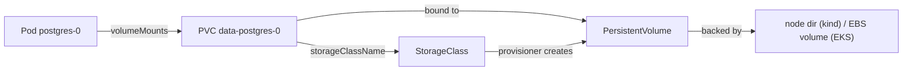

# 08 Storage and StatefulSets (Weeks 3-6)

**Goal**: move Postgres from Docker Desktop into the cluster, understand the PV/PVC/StorageClass chain, and prove the data survives pod restarts and rescheduling. Also learn why stateful workloads are harder.

## The storage chain



| Object | Who creates it | Meaning |
| --- | --- | --- |
| **StorageClass** | Cluster admin | "How to make volumes": provisioner, parameters, reclaim policy, binding mode |
| **PersistentVolumeClaim** | You (or a StatefulSet template) | "I need 1Gi, ReadWriteOnce" |
| **PersistentVolume** | The provisioner, dynamically | The actual volume, bound 1:1 to a PVC |

On kind, the `standard` StorageClass uses **local-path-provisioner**: a directory on one node's disk. On EKS (note 14) it'll be the **EBS CSI driver** creating gp3 volumes.

```bash
kubectl get storageclass
kubectl get sc standard -o yaml | grep -E 'provisioner|reclaimPolicy|volumeBindingMode'
```

Fields that matter:
- **`volumeBindingMode: WaitForFirstConsumer`**: don't create the volume until a pod is scheduled, so it's created where the pod is (the right node, or the right AZ on EKS). `Immediate` can create a volume in a zone where the pod can't run.
- **`reclaimPolicy: Delete`**: deleting the PVC deletes the data. `Retain` keeps the PV and disk for manual recovery.
- **Access modes**: `ReadWriteOnce` (one node at a time, which covers EBS and local-path) and `ReadWriteMany` (many nodes, such as EFS or NFS). Databases use RWO.

## Why a StatefulSet (not a Deployment)

| | Deployment | StatefulSet |
| --- | --- | --- |
| Pod names | Random (`api-7d9f-abcde`) | Stable, ordinal (`postgres-0`) |
| Storage | Shared PVC or none | **One PVC per pod** via `volumeClaimTemplates`. It follows the pod name |
| Network identity | Through the Service only | Stable DNS per pod via a **headless** Service |
| Rollout order | Any order, surge allowed | One at a time, ordered, no surge |
| Delete behaviour | PVCs untouched | PVCs **kept** when the StatefulSet is deleted or scaled down (by default) |

A StatefulSet with `replicas: 1` does **not** make Postgres highly available. It makes it *restartable with its data*. Real HA Postgres needs replication and failover (CloudNativePG operator, Patroni, or a managed service like RDS or Aurora). For taskq, RDS is the production recommendation; the in-cluster StatefulSet exists to teach storage.

## Lab 8.1: Move Postgres into the cluster
The manifest is [k8s/postgres-statefulset/postgres.yaml](taskq/k8s/postgres-statefulset/postgres.yaml).

```bash
# 1. Back up the data from the Docker container
docker exec taskq-pg pg_dump -U taskq -Fc taskq > /tmp/taskq.dump

# 2. Remove the external Service and EndpointSlice (the new headless Service reuses the name)
kubectl -n taskq delete service postgres
kubectl -n taskq delete endpointslice postgres-external

# 3. Deploy Postgres in the cluster
kubectl apply -f k8s/postgres-statefulset/postgres.yaml
kubectl -n taskq rollout status sts/postgres
kubectl -n taskq get pvc,pv
kubectl -n taskq get pod postgres-0 -o wide              # which node holds the data

# 4. Restore
kubectl -n taskq exec -i postgres-0 -- pg_restore -U taskq -d taskq --clean --if-exists < /tmp/taskq.dump
kubectl -n taskq exec postgres-0 -- psql -U taskq -c 'select status, count(*) from jobs group by 1'

# 5. The api and worker keep using postgres.taskq.svc.cluster.local, so restart them for new connections
kubectl -n taskq rollout restart deploy/api deploy/worker
docker stop taskq-pg                                     # prove the old database is unused
curl -s -XPOST localhost:8080/jobs -d '{"payload":{"in":"cluster"}}'
```

The DNS name didn't change, so the apps needed no configuration change. That's the value of a Service as an indirection layer.

From now on, deploy with `make deploy PG_MODE=cluster` (or `export PG_MODE=cluster`), so the Makefile applies the StatefulSet instead of the external endpoint. A fresh cluster after `make reset PG_MODE=cluster` starts with an empty database.

## Lab 8.2: Prove persistence
```bash
kubectl -n taskq delete pod postgres-0
kubectl -n taskq get pod postgres-0 -w                   # recreated with the same name
kubectl -n taskq exec postgres-0 -- psql -U taskq -c 'select count(*) from jobs'   # data still there
```

## Lab 8.3: Local volumes pin pods to nodes
```bash
NODE=$(kubectl -n taskq get pod postgres-0 -o jsonpath='{.spec.nodeName}')
kubectl get pv -o yaml | grep -A8 nodeAffinity             # the PV is tied to $NODE
kubectl cordon $NODE
kubectl -n taskq delete pod postgres-0
kubectl -n taskq get pod postgres-0                         # Pending
kubectl -n taskq describe pod postgres-0 | grep -A3 Events  # volume node affinity conflict
kubectl uncordon $NODE
```

The same thing happens on EKS with **Availability Zones**: an EBS volume lives in one AZ, so its pod can only run on nodes in that AZ. If that AZ has no capacity, the pod stays Pending. Remember this for note 14 and the drills.

## Lab 8.4: What deleting things actually deletes
```bash
kubectl -n taskq delete sts postgres        # pods gone, PVC remains
kubectl -n taskq get pvc
kubectl apply -f k8s/postgres-statefulset/postgres.yaml   # reattaches to the same PVC, data intact
# Only this deletes the data (reclaimPolicy: Delete):
#   kubectl -n taskq delete pvc data-postgres-0
```

## Backups
A PVC isn't a backup: a bad `DELETE`, a corrupted volume, or a deleted namespace all lose data. Backup layers, in order of simplicity:
1. **Logical dumps**: a CronJob running `pg_dump` to S3. Simple and portable. That's taskq's approach in note 17.
2. **Volume snapshots**: the `VolumeSnapshot` API with the CSI driver (EBS snapshots). Crash-consistent.
3. **Cluster backup tools** (Velero): Kubernetes objects plus volume snapshots.
4. **Managed database** (RDS): automated backups and point-in-time recovery. The usual production answer.

A backup you haven't restored is a hope, not a backup. Note 17 includes a restore drill.

**Check yourself**
1. Why is `WaitForFirstConsumer` important on multi-AZ clusters?
2. You scale a StatefulSet from 3 to 1, then back to 3. What happens to the data of `-1` and `-2`?
3. Why is the Postgres Service headless, and what does `dig postgres.taskq.svc.cluster.local` return?
4. Why is `PGDATA` set to a subdirectory of the mount?
