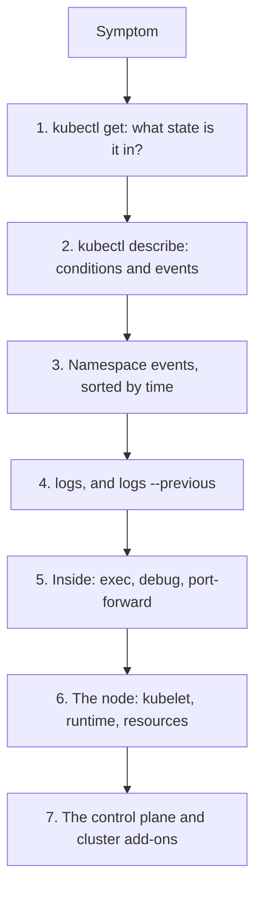

# 10 Kubernetes troubleshooting playbook (Weeks 3-6)

**Goal**: a repeatable order of investigation that works for problems you've never seen before. You'll use this in every drill in weeks 14-16. Keep it open while you work until you don't need to.

## The order of investigation
Go from broad to narrow, and from the API's view to the node's view:



```bash
# 1. State
kubectl -n taskq get pods -o wide
kubectl -n taskq get deploy,rs,sts,svc,endpointslices,pvc
# 2. Detail: read Conditions, Last State, Events at the bottom
kubectl -n taskq describe pod <pod>
# 3. Events (they expire after about 1 hour)
kubectl -n taskq get events --sort-by=.lastTimestamp
kubectl get events -A --field-selector type=Warning
# 4. Logs
kubectl -n taskq logs <pod> [-c container] [--previous] [--since=10m]
kubectl -n taskq logs deploy/api --all-containers --prefix
# 5. Inside
kubectl -n taskq exec -it <pod> -- <cmd>                       # needs a shell or tools in the image
kubectl -n taskq debug -it <pod> --image=nicolaka/netshoot --target=api   # ephemeral container
kubectl -n taskq port-forward <pod> 8080:8080
# 6. Node
kubectl describe node <node>                                   # Conditions, Allocated resources, Taints
docker exec -it <node> bash                                    # kind: crictl ps -a, crictl logs, journalctl -u kubelet
```

`kubectl debug --target=<container>` is essential for distroless images like taskq's. The debug container joins the target's process namespace, so `ps` shows `/api`, and `cat /proc/1/environ` or `ls /proc/1/root/` let you see its environment and filesystem.

## Symptom → cause table

### The pod isn't running

| What you see | Meaning | Where to look | Usual causes |
| --- | --- | --- | --- |
| `Pending`, no node | Scheduler can't place it | `describe pod` events: `FailedScheduling` | Insufficient CPU or memory (requests), taints, nodeSelector or affinity, PVC unbound, volume zone conflict, too many pods per node |
| `Pending`, has a node | Kubelet is preparing | Events | Pulling the image, mounting volumes, Secret or ConfigMap missing |
| `ContainerCreating` for a long time | Sandbox or volume setup | Events: `FailedMount`, `FailedCreatePodSandBox` | Missing Secret or ConfigMap, PVC attach failure, CNI out of IPs (EKS) |
| `ErrImagePull` / `ImagePullBackOff` | Can't fetch the image | Events: the registry's message | Wrong name or tag, private registry without `imagePullSecrets` or IAM, image not loaded into kind, `:latest` forcing a pull |
| `CreateContainerConfigError` | Pod spec refers to something missing | Events | `secretKeyRef` or `configMapKeyRef` to a missing key, non-numeric user with `runAsNonRoot` |
| `CrashLoopBackOff` | It starts, then exits, repeatedly | `logs --previous`, `Last State` exit code | App error on start (bad config, can't parse env), dependency missing and the app exits, liveness killing it, OOMKilled |
| `OOMKilled` (Last State) | Container exceeded its memory limit | `describe pod`, metrics | Leak, limit too low, missing `GOMEMLIMIT` |
| `Evicted` | Node under pressure | `describe pod` message | Node memory or disk pressure. Check the node |
| `Terminating` forever | Finalizer or unreachable node | `get pod -o yaml` (finalizers), node status | Node down (the pod can't confirm deletion), stuck finalizer |

### The pod runs, but it doesn't work

| What you see | Where to look | Usual causes |
| --- | --- | --- |
| `Running`, `0/1 Ready` | `describe pod` readiness failures, `/readyz` output | Dependency down (Postgres), probe on the wrong path or port, slow start without a startup probe |
| `RESTARTS` climbing, no OOM | `describe pod` "Liveness probe failed", `logs --previous` | Liveness too aggressive, CPU throttling making probes time out, real deadlock |
| Service unreachable | `get endpointslices`, selector vs labels | Selector mismatch, pods not ready, `targetPort` wrong, NetworkPolicy |
| Works by pod IP, not by name | DNS: `dig` from a debug pod, CoreDNS pods and logs | CoreDNS down, ndots or search issues, wrong namespace in the name |
| Slow or timeouts | `kubectl top`, throttling metrics, app logs | CPU limit throttling, DB connections exhausted, node overloaded |
| `Forbidden` from the API | Note 09 checklist | Missing Role or binding, wrong ServiceAccount |

### Exit codes

| Code | Meaning |
| --- | --- |
| 0 | Exited normally. For a Deployment this still causes a restart, because pods are expected to run forever |
| 1, 2 | Application error. Read the logs |
| 126, 127 | Command not executable or not found. Wrong `command`, for example `/workr` |
| 137 | SIGKILL: OOMKilled, or killed after the grace period |
| 143 | SIGTERM, a normal graceful stop |

## Rollout problems
```bash
kubectl -n taskq rollout status deploy/api --timeout=2m
kubectl -n taskq rollout history deploy/api
kubectl -n taskq get rs -l app.kubernetes.io/name=api          # old vs new ReplicaSet, desired/current/ready
kubectl -n taskq describe deploy api | grep -A5 Conditions     # Progressing=False: ProgressDeadlineExceeded
kubectl -n taskq rollout undo deploy/api [--to-revision=N]
```

## Useful one-liners
```bash
# Pods that aren't Running or Succeeded, cluster-wide
kubectl get pods -A --field-selector=status.phase!=Running,status.phase!=Succeeded
# Why each container last terminated
kubectl -n taskq get pods -o custom-columns='POD:.metadata.name,REASON:.status.containerStatuses[*].lastState.terminated.reason,EXIT:.status.containerStatuses[*].lastState.terminated.exitCode'
# What image is actually running
kubectl -n taskq get pods -o custom-columns='POD:.metadata.name,IMAGE:.status.containerStatuses[*].imageID'
# Every object in the namespace
kubectl -n taskq get all,cm,secret,pvc,endpointslices,pdb,sa,role,rolebinding
# The effective spec after defaults and admission
kubectl -n taskq get pod <pod> -o yaml
```

## Readiness check for Weeks 3-6
Do this without notes and time yourself:
1. `make reset`, then deploy taskq from the manifests, including moving Postgres into the cluster.
2. Ask someone (or use the break list below, picking blindly) to break one thing, and find it in under 10 minutes using only the order above.

Break list (write each on a card, draw one):
- Service selector typo
- Secret key renamed (`DATABASE_URL` → `DB_URL`)
- Image tag that doesn't exist
- Worker `command: ["/workr"]`
- Memory limit `16Mi` on the api
- Liveness probe pointed at `/readyz` while Postgres is stopped
- `requests.cpu: 8` on the worker
- Taint both workers with `NoSchedule`
- The Postgres PVC's node cordoned and the pod deleted
- The api ServiceAccount deleted

When you can find all ten from symptoms alone, you're ready for EKS.
