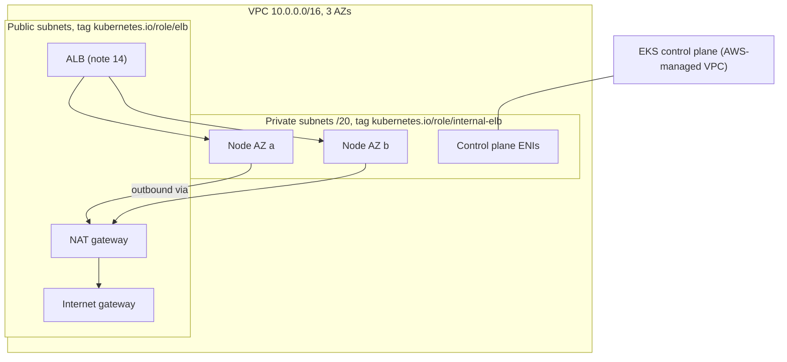

# 11 Terraform VPC and EKS cluster (Weeks 7-10)

**Goal**: provision a small but production-shaped EKS environment with Terraform, explain every resource it creates, and tear it down cleanly every session.

The code is in [taskq/terraform/eks](taskq/terraform/eks). It uses the community modules `terraform-aws-modules/vpc`, `terraform-aws-modules/eks` and `terraform-aws-modules/eks-pod-identity`. They're widely used and readable, and reading their source is part of the learning. (See also the repo's [Terraform notes](../Terraform) and [EKS notes](../AWS%20EKS).)

## Cost and safety first

| Resource | Approximate cost |
| --- | --- |
| EKS control plane (standard support) | USD 0.10/hour |
| 2 × t3.medium nodes | about USD 0.09/hour |
| NAT gateway (1) | about USD 0.05/hour plus data |
| ALB (from note 14) | about USD 0.025/hour plus LCUs |
| EBS gp3 1 GiB, S3, ECR | Cents |

That's roughly **USD 6-8 per day if left running**. So:
1. Set an **AWS Budget** alert (for example USD 30/month) before your first `apply`.
2. Use a **sandbox account**, not one with anything important in it.
3. `terraform destroy` at the end of **every** session. Rebuilding takes about 15 minutes, and practising it is part of the skill.

## Prerequisites
```bash
brew install awscli
aws configure sso          # or use an existing profile: export AWS_PROFILE=sandbox
aws sts get-caller-identity
terraform version          # >= 1.9
```

The IAM identity running Terraform becomes the cluster admin (`enable_cluster_creator_admin_permissions = true`). Note which role that is.

## What gets created



| Resource | Purpose | Why it's needed |
| --- | --- | --- |
| VPC, 3 AZs | Network boundary | EKS needs subnets in at least 2 AZs |
| **Public subnets** (/24) | Internet gateway route. ALBs and the NAT gateway live here | Tagged `kubernetes.io/role/elb=1` so the LB controller picks them for internet-facing ALBs |
| **Private subnets** (/20) | Nodes **and pods** (VPC CNI gives pods VPC IPs) | Size matters: every pod uses one IP (note 12). Tagged `internal-elb` for internal LBs |
| NAT gateway (single) | Outbound internet for private nodes (pull images, reach the AWS APIs) | Production uses one per AZ so an AZ failure doesn't cut egress |
| **EKS cluster** | Managed control plane (API server, etcd) in an AWS-owned VPC, with ENIs in your private subnets | You never see the control-plane instances |
| Cluster IAM role and security groups | Lets EKS manage ENIs. Cluster and node SGs allow control plane ↔ kubelet traffic | Created by the module |
| **Managed node group** | An Auto Scaling group of AL2023 EC2 instances that EKS updates and drains for you | Note 12 |
| **Add-ons** | `vpc-cni`, `kube-proxy`, `coredns`, `eks-pod-identity-agent`, `aws-ebs-csi-driver` | AWS-managed versions of core components |
| **Access entry** for the creator | Maps your IAM identity to cluster-admin | Note 13 |
| **Pod Identity** roles and associations | EBS CSI driver, LB controller, taskq worker → IAM roles | Note 13 |
| S3 bucket | Worker job results | Gives workload IAM a purpose |
| ECR repository | Stores the taskq image (immutable tags, scan on push) | EKS nodes can't see your local Docker |

`before_compute = true` on `vpc-cni` and `eks-pod-identity-agent` makes Terraform install those add-ons before creating the nodes. Without the CNI, nodes join but stay `NotReady` because pods can't get IPs.

## Lab 11.1: Provision
```bash
cd Kubernetes/taskq/terraform/eks
terraform init
terraform plan -out=tfplan      # read it: about 60-80 resources. Find the cluster, node group, NAT gateway
terraform apply tfplan          # 12-18 minutes
$(terraform output -raw configure_kubectl)
kubectl config current-context  # taskq-eks
```

`terraform output` gives the bucket name, ECR URL and subnets. You'll use them in notes 13 and 14.

## Lab 11.2: Explore what you built
```bash
kubectl get nodes -o wide                         # private IPs, AL2023, containerd
kubectl get nodes -L topology.kubernetes.io/zone,node.kubernetes.io/instance-type,eks.amazonaws.com/nodegroup
kubectl -n kube-system get pods -o wide           # aws-node (VPC CNI), kube-proxy, coredns, eks-pod-identity-agent, ebs-csi
kubectl get sc
aws eks describe-cluster --name taskq --query 'cluster.{version:version,endpoint:endpoint,auth:accessConfig}'
aws eks list-addons --cluster-name taskq
aws eks list-access-entries --cluster-name taskq
aws eks list-pod-identity-associations --cluster-name taskq
aws ec2 describe-subnets --filters Name=vpc-id,Values=$(terraform output -raw vpc_id) \
  --query 'Subnets[].{az:AvailabilityZone,cidr:CidrBlock,free:AvailableIpAddressCount,tags:Tags[?Key==`Name`].Value|[0]}' --output table
```

Compare with kind. What's missing compared with your local cluster (no control-plane node in `kubectl get nodes`, no kindnet), and what's new (`aws-node`, the pod identity agent)?

## Lab 11.3: Deploy taskq (manual, on purpose)
```bash
cd Kubernetes/taskq
ECR=$(terraform -chdir=terraform/eks output -raw ecr_repository_url)
aws ecr get-login-password | docker login --username AWS --password-stdin ${ECR%%/*}
docker build --platform linux/amd64 -t $ECR:v1 . && docker push $ECR:v1

kubectl apply -f k8s/00-namespace.yaml
kubectl apply -f k8s/eks/storageclass-gp3.yaml
kubectl apply -f k8s/postgres-statefulset/
kubectl apply -f k8s/
kubectl -n taskq set image deploy/api api=$ECR:v1
kubectl -n taskq set image deploy/worker worker=$ECR:v1
kubectl -n taskq rollout status deploy/api
kubectl -n taskq port-forward svc/api 8080:80 &
curl -s -XPOST localhost:8080/jobs -d '{"payload":{"on":"eks"}}'
```

Notice the friction: `kubectl set image` after `apply` means the files in Git no longer describe what's running. That's the problem Helm and GitOps solve in note 15.

## Teardown (the order matters)
Some AWS resources are created **by controllers inside the cluster**, not by Terraform: the ALB (by the LB controller) and EBS volumes (by the CSI driver). Terraform doesn't know about them. If you destroy the VPC first, it fails on dependencies (ENIs, security groups), or you leak resources that keep costing money.

```bash
kubectl delete ingress --all -A                 # LB controller deletes the ALB and target groups
kubectl -n taskq delete sts postgres
kubectl -n taskq delete pvc --all               # CSI driver deletes the EBS volumes
sleep 60                                        # let the controllers finish
helm uninstall aws-load-balancer-controller -n kube-system   # if installed (note 14)
cd terraform/eks && terraform destroy
aws ec2 describe-volumes --filters Name=tag:kubernetes.io/created-for/pvc/namespace,Values=taskq --query 'Volumes[].VolumeId'
aws elbv2 describe-load-balancers --query 'LoadBalancers[?contains(LoadBalancerName, `k8s-taskq`)].LoadBalancerArn'
```

Both final queries should return empty lists.

**Check yourself**
1. Why are nodes in private subnets, and how do they still pull images from the internet?
2. What breaks if the public subnets lack the `kubernetes.io/role/elb` tag?
3. Why must the Ingress be deleted before `terraform destroy`?
4. Where does the EKS control plane run, and what in your VPC connects to it?
