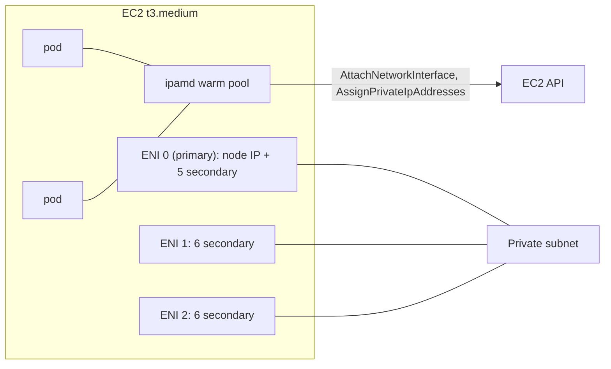

# 12 VPC CNI and managed node groups (Weeks 7-10)

**Goal**: explain where a pod's IP comes from on EKS, calculate how many pods fit on a node and in a subnet, and understand what a managed node group does for you.

## kindnet vs the Amazon VPC CNI

| | kind (kindnet) | EKS (VPC CNI) |
| --- | --- | --- |
| Pod IPs | Overlay range (`10.244.x.x`), not visible outside the cluster | **Real VPC IPs** from the node's subnet |
| Routing between nodes | Routes added on each node | Native VPC routing, no overlay |
| Reach a pod from outside the cluster | No | Yes, from anything in the VPC with security groups allowing it. That's why ALB `target-type: ip` works |
| Limits | The node's pod CIDR (/24) | **ENIs per instance × IPs per ENI**, and **free IPs in the subnet** |

## How the VPC CNI assigns IPs
The `aws-node` DaemonSet runs on every node and has two parts:
- **ipamd** (IP address management daemon) attaches extra **ENIs** to the EC2 instance and allocates **secondary IPs** on them. It keeps a **warm pool** so new pods start fast.
- The **CNI plugin** binary, called by the kubelet for each new pod, takes an IP from the warm pool, creates the veth pair and sets up routes.



### Max pods per node (secondary IP mode)
```
max pods = ENIs × (IPv4 addresses per ENI − 1) + 2
```

The `−1` is each ENI's primary IP (not used for pods). The `+2` is for host-network pods (`aws-node`, `kube-proxy`), which use the node IP.

| Instance | ENIs | IPs per ENI | Max pods |
| --- | --- | --- | --- |
| t3.small | 3 | 4 | 11 |
| **t3.medium** (taskq) | 3 | 6 | **17** |
| m5.large | 3 | 10 | 29 |
| m5.xlarge | 4 | 15 | 58 |

Small instances fill up on **pod count** long before CPU or memory. Before scheduling anything, a t3.medium already runs `aws-node`, `kube-proxy`, the pod identity agent, the EBS CSI node pod, and maybe CoreDNS. Count them.

```bash
kubectl get nodes -o custom-columns=NAME:.metadata.name,PODS:.status.allocatable.pods,TYPE:.metadata.labels.node\\.kubernetes\\.io/instance-type
kubectl get pods -A -o wide --field-selector spec.nodeName=<node> | wc -l
aws ec2 describe-instance-types --instance-types t3.medium --query 'InstanceTypes[].NetworkInfo.{enis:MaximumNetworkInterfaces,ips:Ipv4AddressesPerInterface}'
```

### Prefix delegation
With `ENABLE_PREFIX_DELEGATION=true` (the `enable_prefix_delegation` Terraform variable), ipamd assigns **/28 prefixes** (16 IPs) to each ENI slot instead of single IPs. The node can then run far more pods (capped at 110 for instances under 30 vCPUs). The trade-offs:
- It uses subnet space in **contiguous /28 blocks**, so fragmented subnets can fail to provide a prefix even with free IPs.
- Only **new** nodes get the new max-pods value. Replace the nodes after changing it.

### Subnet IPs: the other limit
Every pod, every node, every warm-pool IP and every control-plane ENI takes an IP from the subnet. A /20 has 4091 usable addresses; a /24 has 251. Subnets are hard to resize later, so size them generously. Ways out of IP exhaustion:
- A larger VPC CIDR for new subnets (add a secondary CIDR)
- **Custom networking**: pods use separate subnets (for example from the `100.64.0.0/10` range) from nodes
- Prefix delegation (a denser allocation)
- **Tune the warm pool**: `WARM_IP_TARGET` / `MINIMUM_IP_TARGET` instead of the default warm ENI, so each node holds fewer idle IPs
- IPv6 clusters

### Lab 12.1: Watch IP allocation
```bash
NODE=$(kubectl get nodes -o jsonpath='{.items[0].metadata.name}')
INSTANCE=$(kubectl get node $NODE -o jsonpath='{.spec.providerID}' | cut -d/ -f5)
aws ec2 describe-instances --instance-ids $INSTANCE \
  --query 'Reservations[].Instances[].NetworkInterfaces[].{eni:NetworkInterfaceId,ips:length(PrivateIpAddresses)}'
kubectl -n taskq scale deploy/worker --replicas=12
kubectl get pods -n taskq -o wide           # pod IPs are from the private subnet CIDRs
# run the describe-instances command again: more ENIs and IPs attached
kubectl -n kube-system logs ds/aws-node -c aws-node --tail=20
```

### Lab 12.2: Hit the pod limit
```bash
kubectl -n taskq scale deploy/worker --replicas=40
kubectl -n taskq get pods | grep Pending | head -3
kubectl -n taskq describe pod <pending-pod> | grep -A3 Events   # "Too many pods"
kubectl -n taskq scale deploy/worker --replicas=2
```

"Too many pods" (max-pods reached) is different from pods stuck in `ContainerCreating` with `failed to assign an IP address to container` (subnet or ENI exhaustion). The second one is drill 3 in note 18.

## Security groups
- The **cluster security group** is attached to control-plane ENIs and managed nodes, and allows the two to talk.
- By default **pods share the node's security group**. *Security groups for pods* (branch ENIs, supported on Nitro instances) can give specific pods their own SG, for example allowing only the worker to reach RDS.

## Managed node groups

| | Managed node group | Self-managed | Karpenter | EKS Auto Mode |
| --- | --- | --- | --- | --- |
| Who launches nodes | An EKS-managed ASG | Your ASG and launch template | Karpenter, calling EC2 directly | AWS |
| AMI updates | `UpdateNodegroupVersion` does a rolling replace with **drain** | You | Drift detection and replace | AWS |
| Scaling | Cluster Autoscaler (or manual sizes) | Cluster Autoscaler | Built in, picks instance types per pending pod | Built in |
| Good for | Learning, steady workloads | Custom needs | Cost and speed at scale | Least operations |

taskq uses **one managed node group**: AL2023, t3.medium, 2-4 nodes, `max_unavailable = 1` during updates. You can see what it manages:

```bash
aws eks describe-nodegroup --cluster-name taskq --nodegroup-name $(aws eks list-nodegroups --cluster-name taskq --query 'nodegroups[0]' --output text) \
  --query 'nodegroup.{ami:amiType,release:releaseVersion,scaling:scalingConfig,update:updateConfig,asg:resources.autoScalingGroups}'
```

When a managed node group replaces a node (AMI update or version upgrade), it:
1. Launches a new node and waits for it to be `Ready`.
2. Cordons the old node and **evicts** its pods, respecting PodDisruptionBudgets for up to 15 minutes, then forcing.
3. Terminates the old instance.

This is why PDBs (note 17) and graceful shutdown (note 06) matter on EKS.

### Lab 12.3: Scale the node group
The EKS module **ignores `desired_size` changes after creation** (`lifecycle.ignore_changes`), so that an autoscaler can own the number without Terraform fighting it. Changing `node_desired_size` and running `apply` does nothing. Scale with the API instead:

```bash
NG=$(aws eks list-nodegroups --cluster-name taskq --query 'nodegroups[0]' --output text)
aws eks update-nodegroup-config --cluster-name taskq --nodegroup-name $NG --scaling-config minSize=2,maxSize=4,desiredSize=3
kubectl get nodes -w                         # a third node joins in 2-3 minutes
aws eks update-nodegroup-config --cluster-name taskq --nodegroup-name $NG --scaling-config minSize=2,maxSize=4,desiredSize=2
kubectl get nodes -w                         # which node got removed, and what happened to its pods?
```

`min_size` and `max_size` are still managed by Terraform.

**Check yourself**
1. Calculate max pods for an m5.large. Why does a cluster of t3.small nodes run out of pod slots before CPU?
2. Pods are stuck in `ContainerCreating` with an IP assignment error, but nodes have plenty of CPU. List three causes.
3. What does the warm pool trade off?
4. Why does ALB `target-type: ip` work on EKS but would not with kindnet?
