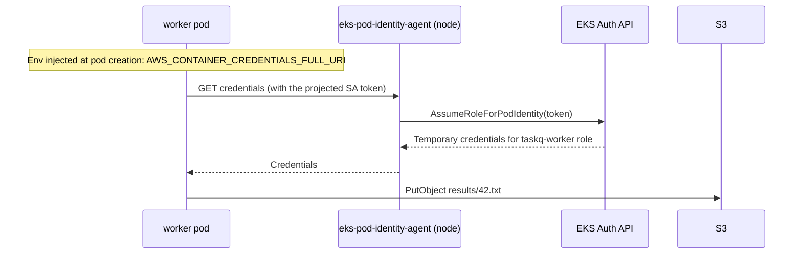

# 13 Cluster access and workload IAM (Weeks 7-10)

**Goal**: explain the two directions of AWS ↔ Kubernetes identity. **People and CI → the cluster** uses access entries. **Pods → AWS APIs** uses Pod Identity. Then give the worker exactly the S3 access it needs and nothing more.

| Direction | Question | EKS mechanism |
| --- | --- | --- |
| IAM principal → Kubernetes API | "This IAM role is calling `kubectl get pods`. Who is it in Kubernetes?" | **Access entries** (older: the `aws-auth` ConfigMap) |
| Pod → AWS API | "This pod is calling `s3:PutObject`. Which IAM role does it act as?" | **EKS Pod Identity** (older: IRSA) |

## Part 1: Cluster access (humans and CI)

### How `kubectl` authenticates to EKS
1. `aws eks update-kubeconfig` writes a kubeconfig whose user runs `aws eks get-token` (an exec credential plugin).
2. `get-token` creates a **pre-signed STS `GetCallerIdentity` URL** for your current IAM identity and sends it as the bearer token.
3. EKS verifies it with STS and learns your IAM ARN.
4. **Access entries** map that ARN to a Kubernetes username and groups, and optionally to EKS **access policies**.
5. Kubernetes RBAC (note 09) then authorizes the request, alongside any access policies.

```bash
kubectl config view --minify -o jsonpath='{.users[0].user.exec}' | jq
aws sts get-caller-identity
kubectl auth whoami          # username arn:aws:sts::...:assumed-role/..., groups
```

### Access entries

| Field | Meaning |
| --- | --- |
| `principal_arn` | The IAM role or user (use roles, for example an SSO permission-set role) |
| `kubernetes_groups` | Groups for RBAC. taskq maps a viewer role to `taskq-viewers`, bound in [60-rbac.yaml](taskq/k8s/60-rbac.yaml) |
| Access policy associations | AWS-managed policies such as `AmazonEKSClusterAdminPolicy`, `AmazonEKSViewPolicy`, scoped to the cluster or to namespaces |

Two ways to authorize an access entry. Pick one per use case:
- **Access policies**: no RBAC objects needed, and managed entirely in AWS (IAM and Terraform). Good for admin and broad roles.
- **`kubernetes_groups` + your own RBAC**: fine-grained and Kubernetes-native. This is taskq's viewer example.

The cluster creator gets admin through an access entry (`enable_cluster_creator_admin_permissions`). It's visible and removable, unlike the old hidden creator-admin behaviour.

### Lab 13.1: A read-only role for a teammate
1. Create an IAM role `taskq-viewer` that your account can assume, with permission `eks:DescribeCluster` (needed by `update-kubeconfig`).
2. Apply Terraform with `-var viewer_role_arn=arn:aws:iam::<acct>:role/taskq-viewer`.
3. Assume it and test:

```bash
aws eks list-access-entries --cluster-name taskq
aws eks update-kubeconfig --name taskq --alias taskq-viewer --role-arn arn:aws:iam::<acct>:role/taskq-viewer
kubectl --context taskq-viewer auth whoami
kubectl --context taskq-viewer -n taskq get pods         # allowed
kubectl --context taskq-viewer -n taskq get secrets      # Forbidden
kubectl --context taskq-viewer get nodes                 # Forbidden (no cluster-scope binding)
```

**Common failure**: `error: You must be logged in to the server (Unauthorized)` means *authentication* failed. There's no access entry for this ARN, or you're using a different identity than you think. Check `aws sts get-caller-identity`. `Forbidden` means *authentication* worked but *RBAC* said no.

## Part 2: Workload IAM (pods to AWS)

### Never do this
- Put AWS access keys in a Secret or environment variable.
- Give the **node's** IAM role S3 permissions. Every pod on the node could use the instance profile through IMDS. The EKS module's node groups require IMDSv2 with a **hop limit of 1**, so a pod's request (one extra network hop through its veth) never gets a response. Keep it that way: it's also why a pod without Pod Identity gets "no credentials" rather than the node's role.

### EKS Pod Identity (what taskq uses)



1. Terraform creates an IAM role `taskq-worker` whose trust policy trusts `pods.eks.amazonaws.com`, and a **pod identity association**: (cluster, namespace `taskq`, ServiceAccount `worker`) → role. See `module "worker_pod_identity"` in [main.tf](taskq/terraform/eks/main.tf).
2. When a pod using ServiceAccount `worker` is **created**, EKS injects the environment variables `AWS_CONTAINER_CREDENTIALS_FULL_URI` and `AWS_CONTAINER_AUTHORIZATION_TOKEN_FILE`, plus a projected token volume.
3. The AWS SDK's default credential chain finds those variables and asks the node-local agent, which exchanges the token for role credentials. The worker code just calls `config.LoadDefaultConfig`, with no AWS-specific setup.

The role's policy allows only `s3:PutObject` on `arn:aws:s3:::<bucket>/results/*`. The api uses ServiceAccount `api`, which has no association, so it gets no AWS credentials at all.

### Lab 13.2: Turn on S3 uploads
```bash
BUCKET=$(terraform -chdir=terraform/eks output -raw results_bucket)
REGION=$(terraform -chdir=terraform/eks output -raw region)
kubectl -n taskq set env deploy/worker RESULTS_BUCKET=$BUCKET AWS_REGION=$REGION
kubectl -n taskq rollout status deploy/worker

# Proof that credentials were injected (distroless has no `env`, so read the spec)
kubectl -n taskq get pod -l app.kubernetes.io/name=worker -o yaml | grep -A1 AWS_CONTAINER

curl -s -XPOST localhost:8080/jobs -d '{"payload":{"s3":true}}'     # through the port-forward
aws s3 ls s3://$BUCKET/results/
```

### Lab 13.3: Prove least privilege
1. **Wrong ServiceAccount**: change the worker to `serviceAccountName: api` (`kubectl -n taskq edit deploy worker`). Jobs fail with a "no valid credential sources" error (`failed to retrieve credentials`), visible in `GET /jobs/<id>` as `status: failed`. Revert.
2. **Wrong action**: change `results/` to `out/` in [main.tf](taskq/terraform/eks/main.tf)'s resource ARN and apply. Uploads fail with `AccessDenied`. Read the error: it names the role ARN and the action. Revert.
3. **Association created after the pod**: delete the association, restart the worker, recreate the association, and observe that existing pods still fail until restarted. Injection happens at pod **creation**.

These are drill 4 in note 18.

### IRSA, for comparison
IAM Roles for Service Accounts came before Pod Identity and is still everywhere:

| | Pod Identity | IRSA |
| --- | --- | --- |
| Trust setup | Role trusts `pods.eks.amazonaws.com`, the same for every cluster | Per-cluster **OIDC provider** in IAM. The trust policy names the cluster's OIDC issuer and `system:serviceaccount:ns:name` |
| Link SA → role | **Association** in the EKS API (Terraform `aws_eks_pod_identity_association`) | **Annotation** on the ServiceAccount: `eks.amazonaws.com/role-arn` |
| Reuse a role across clusters | Yes, no trust change | Edit the trust policy for each cluster's OIDC provider |
| Node component | `eks-pod-identity-agent` DaemonSet | None (the SDK calls STS `AssumeRoleWithWebIdentity` directly) |
| Session tags (ABAC) | Yes: cluster, namespace, SA name | No |
| Works outside EKS (self-managed clusters) | No | Yes, with any OIDC issuer |

Recognise IRSA by the SA annotation and the `AWS_ROLE_ARN` / `AWS_WEB_IDENTITY_TOKEN_FILE` env vars. The debugging is the same: right SA, right trust, right policy, pod recreated after the change.

## Debugging AccessDenied from a pod: the checklist
1. Which ServiceAccount does the pod use? `kubectl get pod -o jsonpath='{.spec.serviceAccountName}'`
2. Is there an association for exactly that namespace and SA? `aws eks list-pod-identity-associations --cluster-name taskq --namespace taskq`
3. Were the credentials injected? Look for the `AWS_CONTAINER_*` env vars in the pod spec. If missing, the pod predates the association, so restart it.
4. Is the agent healthy on that node? `kubectl -n kube-system get pods -l app.kubernetes.io/name=eks-pod-identity-agent -o wide`
5. Does the role's policy allow the action and resource in the error message? Use the IAM policy simulator, or read the policy.
6. Is something else denying it? A bucket policy, SCP, KMS key policy, or permissions boundary.

**Check yourself**
1. `Unauthorized` vs `Forbidden` from kubectl: which layer failed in each case?
2. Why is giving the node role S3 access a security problem?
3. You add a Pod Identity association, but the running worker still has no credentials. Why?
4. Name two reasons Pod Identity is easier to operate than IRSA across many clusters.
