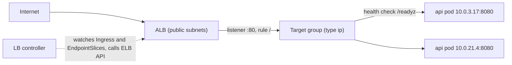

# 14 Load balancing and EBS storage (Weeks 7-10)

**Goal**: expose the api to the internet through an ALB, run Postgres on an EBS volume, and explain every AWS resource the in-cluster controllers create on your behalf.

## Part 1: Load balancing

### Options on EKS

| Kubernetes object | Controller | AWS result | Layer |
| --- | --- | --- | --- |
| `Service type: LoadBalancer` | AWS Load Balancer Controller (with annotations), or the legacy in-tree controller | **NLB** | L4 TCP/UDP |
| `Ingress` (`ingressClassName: alb`) | AWS Load Balancer Controller | **ALB**: listeners, rules, target groups | L7 HTTP/HTTPS |
| Gateway API (`Gateway`, `HTTPRoute`) | AWS Load Balancer Controller (newer versions), others | ALB or NLB | L4/L7 |

taskq uses an **Ingress with an ALB**: HTTP routing and health checks, TLS with ACM, and WAF integration if you need it later.

### Install the AWS Load Balancer Controller
Its IAM permissions come from the Pod Identity association `lb_controller_pod_identity` in [main.tf](taskq/terraform/eks/main.tf). The chart creates the ServiceAccount that the association expects.

```bash
brew install helm
helm repo add eks https://aws.github.io/eks-charts && helm repo update
helm install aws-load-balancer-controller eks/aws-load-balancer-controller -n kube-system \
  --set clusterName=taskq \
  --set serviceAccount.name=aws-load-balancer-controller \
  --set region=$(terraform -chdir=terraform/eks output -raw region) \
  --set vpcId=$(terraform -chdir=terraform/eks output -raw vpc_id)
kubectl -n kube-system rollout status deploy/aws-load-balancer-controller
kubectl get ingressclass                    # alb
```

This is Helm's first appearance: here it's just a package manager for someone else's software. You'll write your own chart in note 15.

### What happens when you apply the Ingress



The controller:
1. Sees an `Ingress` with class `alb`.
2. Finds public subnets by the `kubernetes.io/role/elb` tag (one per AZ).
3. Creates an ALB, a security group, a listener on 80, and a target group of type **ip**.
4. Registers **pod IPs** from the api Service's EndpointSlices. It updates them as pods come and go, which is why the ALB health check (`/readyz`) and Kubernetes readiness should agree.
5. Writes the ALB DNS name to the Ingress's `status.loadBalancer`.

### Lab 14.1: Expose the api
The manifest is [k8s/eks/ingress.yaml](taskq/k8s/eks/ingress.yaml).

```bash
kubectl apply -f k8s/eks/ingress.yaml
kubectl -n taskq get ingress api -w          # ADDRESS appears after about 2 minutes
ALB=$(kubectl -n taskq get ingress api -o jsonpath='{.status.loadBalancer.ingress[0].hostname}')
curl -s -XPOST http://$ALB/jobs -d '{"payload":{"via":"alb"}}'
kubectl -n taskq describe ingress api          # events from the controller
kubectl -n kube-system logs deploy/aws-load-balancer-controller --tail=30
```

Now explain each AWS resource you can find:

```bash
aws elbv2 describe-load-balancers --query 'LoadBalancers[?contains(DNSName, `'$ALB'`)].[LoadBalancerArn,Scheme,AvailabilityZones[].SubnetId]'
aws elbv2 describe-target-groups --query 'TargetGroups[?contains(TargetGroupName, `k8s-taskq`)].[TargetGroupArn,TargetType,HealthCheckPath]'
aws elbv2 describe-target-health --target-group-arn <tg-arn>     # pod IPs and their health
```

### Lab 14.2: Rolling update behind the ALB
```bash
rm -f /tmp/alb.txt
while true; do curl -s -o /dev/null -m 2 -w '%{http_code}\n' http://$ALB/readyz >> /tmp/alb.txt; sleep 0.2; done &
kubectl -n taskq rollout restart deploy/api && kubectl -n taskq rollout status deploy/api
sleep 20; kill %1; sort /tmp/alb.txt | uniq -c
```

If you see 502s, the cause is usually that pods exit before the ALB has deregistered them. The `preStop` sleep (note 06), the deregistration delay annotation, and the controller's **pod readiness gates** (label the namespace `elbv2.k8s.aws/pod-readiness-gate-inject=enabled`, so a pod isn't Ready until its ALB target is healthy) close that gap. Try the readiness gate and compare the counts.

### TLS on the ALB
Request an ACM certificate for your domain, add the `certificate-arn`, `listen-ports` and `ssl-redirect` annotations (commented in the manifest), and point DNS (Route 53 alias) at the ALB. TLS terminates at the ALB; traffic to pods is plain HTTP inside the VPC (note 03).

## Part 2: EBS storage

### The EBS CSI driver
- The **controller** Deployment (ServiceAccount `ebs-csi-controller-sa`, IAM through Pod Identity) calls `CreateVolume`, `AttachVolume` and `DeleteVolume`.
- The **node** DaemonSet formats and mounts the attached device into the pod.
- The **StorageClass** [k8s/eks/storageclass-gp3.yaml](taskq/k8s/eks/storageclass-gp3.yaml) says: gp3, encrypted, `WaitForFirstConsumer`, expandable, and default class.

```bash
kubectl get sc                                # gp3 (default). Older clusters may also have gp2
kubectl -n kube-system get pods -l app.kubernetes.io/name=aws-ebs-csi-driver
kubectl -n taskq get pvc,pv
PV=$(kubectl -n taskq get pvc data-postgres-0 -o jsonpath='{.spec.volumeName}')
kubectl get pv $PV -o jsonpath='{.spec.csi.volumeHandle}{"\n"}{.spec.nodeAffinity}{"\n"}'
aws ec2 describe-volumes --volume-ids <vol-id> --query 'Volumes[].{az:AvailabilityZone,type:VolumeType,state:State,attached:Attachments[].InstanceId}'
```

If two StorageClasses are marked default, new PVCs without a class are ambiguous: Kubernetes picks the newest one. Keep exactly one default.

### The AZ rule
**An EBS volume exists in one Availability Zone and attaches to one instance at a time.** Consequences:
- `postgres-0` can only run on nodes in its volume's AZ. The PV has `nodeAffinity` on `topology.kubernetes.io/zone`.
- If that AZ has no node with room, the pod stays `Pending` with `volume node affinity conflict`.
- Moving a pod to a new node means detach, then attach, which takes from seconds to a minute or so. If the old node died uncleanly, the attachment can take minutes to be released.

### Lab 14.3: Watch a volume follow a pod
```bash
kubectl -n taskq get pod postgres-0 -o wide
NODE=$(kubectl -n taskq get pod postgres-0 -o jsonpath='{.spec.nodeName}')
kubectl get node $NODE -L topology.kubernetes.io/zone
kubectl cordon $NODE && kubectl -n taskq delete pod postgres-0
kubectl -n taskq get pod postgres-0 -o wide -w
# Either it lands on another node in the same AZ, or it stays Pending if none exists
kubectl -n taskq describe pod postgres-0 | grep -A5 Events   # FailedScheduling or SuccessfulAttachVolume
kubectl uncordon $NODE
```

With 2 nodes across 3 AZs, there's often **no other node in the same AZ**. That's the realistic lesson: a single-AZ stateful pod plus a small node group means a node loss is a database outage. Fixes: a node group with at least 2 nodes per AZ used by stateful pods, an operator with replication, or RDS Multi-AZ.

### Lab 14.4: Expand the volume
```bash
kubectl -n taskq patch pvc data-postgres-0 -p '{"spec":{"resources":{"requests":{"storage":"2Gi"}}}}'
kubectl -n taskq get pvc data-postgres-0 -w      # capacity becomes 2Gi without a pod restart
kubectl -n taskq exec postgres-0 -- df -h /var/lib/postgresql/data
```

You can't shrink a volume. And a StatefulSet's `volumeClaimTemplates` are immutable, so new replicas still get 1Gi unless you recreate the StatefulSet (with `--cascade=orphan`).

## Readiness check for Weeks 7-10
From an empty AWS account and without notes, build the environment, deploy taskq, expose it, write to S3, then fill in this table from memory and destroy everything cleanly:

| Component | Purpose | What breaks without it |
| --- | --- | --- |
| VPC, public and private subnets, tags | | |
| NAT gateway | | |
| EKS control plane | | |
| Managed node group | | |
| VPC CNI (`aws-node`) | | |
| kube-proxy | | |
| CoreDNS | | |
| EBS CSI driver and gp3 StorageClass | | |
| Pod Identity agent and associations | | |
| AWS Load Balancer Controller | | |
| Access entries | | |
| ECR | | |
